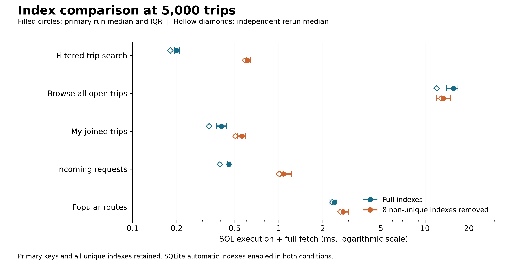
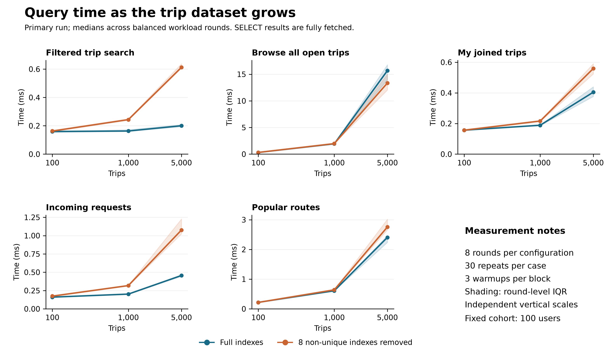

# Evaluation and Results

This section evaluates the SQL access paths of Campus Ride Match as a database course prototype. It reports actual measurements from two complete runs on 10 November 2026. It replaces the earlier September experiment, whose joined-trip query returned no rows and whose index-removal baseline also removed integrity indexes. The earlier timings are not comparable to the corrected workload.

## Experimental Setup

The experiment compares two independent file-backed copies of each generated database. The **full** condition uses the unmodified application schema. The **reduced** condition removes only eight named, non-unique performance indexes:

- `idx_trips_search`, `idx_trips_publisher`
- `idx_requests_trip_status`, `idx_requests_user_status`
- `idx_participants_trip_status`, `idx_participants_user_status`
- `idx_notifications_user_unread`, `idx_reviews_reviewee`

Integer primary-key access, SQLite-created unique indexes and the two partial unique indexes (`uq_requests_active`, `uq_participants_active`) remain intact. `PRAGMA automatic_index=ON` is identical in both conditions: SQLite is allowed to construct transient indexes, although the recorded plans do not require them for this workload. **Reduced does not mean index-free.** This is an ablation of the named index set, not a measurement of each individual index's causal contribution. Notification/review indexes are included in that set but are not used by the five timed queries.

| Setting | Recorded value |
|---|---|
| Python / SQLite / Flask | 3.12.2 / 3.43.1 / 3.1.3 |
| Operating system | Windows 11, build 26200 |
| Processor identifier | AMD64 Family 25 Model 117 Stepping 2, AuthenticAMD |
| Logical processors | 16 |
| Chart renderer | Matplotlib 3.11.2 |
| Fixed cohort / area catalog | 100 synthetic users / 20 areas |
| Dataset sizes | 100, 1,000 and 5,000 trips |
| Random seed / logical local date | 5003 / 2026-11-10, search clock fixed at 12:00 |
| Rounds / warmups / timed repetitions | 8 / 3 per case-condition block / 30 per block |
| Result materialization | `sqlite3.Row`, all rows fetched |
| Query planner statistics | No `ANALYZE`, matching the current application setup |

Page size, cache size, journal mode, retained indexes, UTC start/end times and SHA-256 hashes of the schema, routes and benchmark sources are recorded with each run. The primary run started at `2026-11-10T01:56:00.370562+00:00`. Tests and plotting were run outside the timed experiments. No artificial sleeps, parallel benchmark clients or cache-flushing claims are involved.

All experiment databases live in a temporary directory and are deleted after use. Generation refuses existing files and any destination inside the application's `instance/` directory. Neither the business database nor the demonstration database is initialized or modified.

## Dataset and Workload

### Data generation and validation

A seeded pseudo-random generator creates varied publishers, capacities of 1 to 4 additional seats, publisher party sizes of 1 to 3, routes, departure intervals, requests, historical participation and ratings. The first five origin areas receive higher sampling weights (4 versus 1), representing transport hubs; destinations are selected independently from the remaining areas. These choices are fixed before measurement and are not selected to produce a speedup.

Trip statuses are sampled with weights Open 55%, Full 15%, Completed 22% and Cancelled 8%; actual frequencies vary. Open/Full trips are in the next 30 days; Completed trips are in the previous 30 days. Cancelled trips have no active participation. Capacity matches active participation, pending requests are restricted to active trips, and reviews belong to actual members of completed trips. Ratings use all five levels, with weights 5/10/20/35/30. Accounts use reserved `example.test` addresses and unusable `evaluation-only` password markers.

Publishers and active participants are assigned only when their intervals do not overlap existing reservations. Validation additionally checks completed-trip memberships for historical overlaps. Ended participants are historical records, not current reservations. The generator preserves the same prefix of records when the requested dataset grows with the same seed, date and user count.

The 13 application audit checks, three experiment-specific checks (future Completed trips, expired Open/Full trips and overlapping memberships), `integrity_check`, and `foreign_key_check` passed in both conditions at every size in both runs. Dataset content hashes match before and after index removal and across independent regeneration.

| Trips | Requests | Participation records | Reviews | Notifications | Users with participation history |
|---:|---:|---:|---:|---:|---:|
| 100 | 281 | 135 | 62 | 141 | 76 |
| 1000 | 2688 | 1451 | 682 | 1479 | 100 |
| 5000 | 13389 | 7248 | 3060 | 7591 | 100 |

Participation counts include Active, Left, Removed and TripCancelled rows. At 100 trips, all five rating values occur; at 1,000 and 5,000 trips, all 100 users have participation history. The observed status and rating distributions are saved in `validation.json`.

### Queries and parameter selection

The benchmark extracts SELECT text directly from `campusride/trips.py`; it does not replace the application queries with shorter approximations. A regression test captures SQL executed by the actual Flask routes and checks the expanded SQL, including parameter types, against every benchmark case.

| Query | Application operation and SQL features | Cases per size |
|---|---|---:|
| Filtered search | Date, two areas, inclusive interval overlap and expiry/status/seat filters; users and two area aliases; active-participant LEFT JOIN; GROUP BY and application ordering | 3 |
| Browse open trips | Same search page query with no optional filters; participant counts and ordering preserved | 1 |
| My joined trips | Participation history joined to trips, publisher and two areas; includes historical participation, as the application does | 3 |
| Incoming requests | Requests joined to trips, requester and two areas; pending-first and creation-time ordering | 3 |
| Popular routes | Actual Insights query: two area joins, GROUP BY, count ordering and top five | 1 |

Searches use the 25th/50th/75th-percentile positions of Open trips ordered by ID, using those trips' route, date and interval as valid user inputs. For each user-facing history query, eligible users are ordered by nonzero result count then user ID; the same three percentile positions are chosen. No query timings enter selection. This provides reproducible **successful-query** cases without selecting only the busiest user; unsuccessful searches are not measured.

The parameter selection policy is fixed across sizes, but the actual users/routes can change. The workload deliberately holds the user cohort fixed, so history sizes grow as trips accumulate. Consequently, scaling includes both larger tables and changing result cardinalities, not just a controlled change in table size alone.

| Trips | Filtered search: three cases | Browse | Joined: three cases | Incoming: three cases | Routes |
|---:|---|---:|---|---|---:|
| 100 | 1, 1, 1 | 52 | 1, 2, 2 | 3, 4, 6 | 5 |
| 1000 | 2, 1, 1 | 538 | 12, 14, 17 | 19, 27, 34 | 5 |
| 5000 | 1, 1, 1 | 2814 | 68, 73, 76 | 121, 135, 145 | 5 |

Before timing, both conditions must produce identical full row multisets, including duplicates, and identical ORDER BY key sequences. This permits only legitimate ties whose internal order the application's SQL does not specify. No timed case is empty. Results are rechecked after every measurement block.

## Performance Metrics

`time.perf_counter_ns()` measures `execute()` plus `fetchall()` in milliseconds. Database creation, validation, query-plan capture, hashing, HTTP handling, authentication, migrations, HTML rendering and network/browser work are outside the timer. SQLite's normal connection statement cache and warm database pages remain enabled in both conditions.

Each round shuffles parameter-case order using a recorded deterministic seed. For each case, full/reduced order alternates by round; each condition runs first exactly four times. Both copies remain open and receive three warmups before each 30-execution block. This reduces fixed-order bias but does not eliminate operating-system scheduling or cache effects.

For a query with multiple parameter cases, the calculation is:

1. Take the median of the 30 elapsed times for each case and condition in a round.
2. Take the arithmetic mean of those case medians, assigning each case equal weight.
3. Report the median of the eight round values, plus their 25th/75th percentiles (IQR), 95th percentile, minimum and maximum.

Thus each headline value is a **median round workload time per query execution**, not a percentile over all individual requests. In particular, the saved p95 is a percentile of eight round summaries and must not be described as end-user p95 latency or a confidence interval. Case-level summaries and all 15,840 individual timed executions per run are also retained. All samples, including slow ones, are retained; no outlier trimming is performed.

## Experimental Results

The table reports the primary run. Ratio = reduced/full; values above 1 indicate lower elapsed time with the full index set.

| Trips | Query | Full: median ms | Reduced: median ms | Reduced/full |
|---:|---|---:|---:|---:|
| 100 | Filtered search | 0.1598 | 0.1631 | 1.02 |
| 100 | Browse open trips | 0.3115 | 0.3181 | 1.02 |
| 100 | My joined trips | 0.1566 | 0.1565 | 1.00 |
| 100 | Incoming requests | 0.1599 | 0.1738 | 1.09 |
| 100 | Popular routes | 0.2186 | 0.2161 | 0.99 |
| 1,000 | Filtered search | 0.1631 | 0.2437 | 1.49 |
| 1,000 | Browse open trips | 1.9337 | 1.9758 | 1.02 |
| 1,000 | My joined trips | 0.1887 | 0.2162 | 1.15 |
| 1,000 | Incoming requests | 0.2014 | 0.3178 | 1.58 |
| 1,000 | Popular routes | 0.6085 | 0.6405 | 1.05 |
| 5,000 | Filtered search | 0.2004 | 0.6126 | 3.06 |
| 5,000 | Browse open trips | 15.6768 | 13.3457 | 0.85 |
| 5,000 | My joined trips | 0.4044 | 0.5590 | 1.38 |
| 5,000 | Incoming requests | 0.4556 | 1.0761 | 2.36 |
| 5,000 | Popular routes | 2.4052 | 2.7558 | 1.15 |

At 5,000 trips, round-level variability and the independently regenerated rerun were:

| Query | Primary full IQR, ms | Primary reduced IQR, ms | Rerun full, ms | Rerun reduced, ms | Rerun reduced/full |
|---|---:|---:|---:|---:|---:|
| Filtered search | 0.1935 to 0.2083 | 0.6056 to 0.6377 | 0.1812 | 0.5865 | 3.24 |
| Browse open trips | 13.9533 to 16.7828 | 12.0453 to 14.9926 | 12.0309 | 12.8871 | 1.07 |
| My joined trips | 0.3765 to 0.4395 | 0.5235 to 0.5904 | 0.3332 | 0.5046 | 1.51 |
| Incoming requests | 0.4435 to 0.4641 | 1.0240 to 1.2268 | 0.3952 | 1.0032 | 2.54 |
| Popular routes | 2.2373 to 2.4657 | 2.6578 to 3.0165 | 2.3210 | 2.6364 | 1.14 |



**Figure 1.** Index comparison at 5,000 trips. Filled circles and horizontal bars show primary-run medians and round-level IQRs; hollow diamonds show independent-rerun medians. The horizontal axis is logarithmic. All primary-key and unique indexes remain available in both configurations. [Vector SVG](evaluation/figures/index_comparison.svg).



**Figure 2.** Primary-run SQL execution and full-fetch time as trip count grows. Bands show round-level IQRs; each panel has its own vertical scale, and the trip-count axis is logarithmic. The browse query fetches 52, 538 and 2,814 rows, so its cost is not directly comparable to one-row filtered searches. [Vector SVG](evaluation/figures/query_scaling.svg).

Both complete runs regenerate identical data and workloads and produce identical query plans. Timings do not reproduce bit-for-bit: for example, full-index browse time changes from 15.6768 to 12.0309 ms. The primary run is retained as the primary result; it was not replaced by the rerun with the more favorable browse ratio. `figure_data.csv` and `index_ratios.csv` expose all primary/rerun comparisons.

## Query Plan Analysis

The following observations use the recorded 5,000-trip plans. Exact SQL, bound parameters and every plan row are preserved for all sizes and cases.

| Query | Full index set | Reduced index set | Interpretation |
|---|---|---|---|
| Filtered search | `SEARCH t USING INDEX idx_trips_search`; participant join uses covering `idx_participants_trip_status` | `SCAN t`; participant join still uses `uq_participants_active` | Equality-leading composite access avoids scanning trips for selective filters. The start-time range appears in the access key; the end-time overlap condition remains a filter. |
| Browse open trips | `SCAN t`; covering participant lookup | `SCAN t`; partial-unique participant lookup | Neither plan avoids scanning trips. Many full rows must be joined, fetched and sorted; there is no stable end-to-end query speedup across runs. |
| My joined trips | `SEARCH tp USING INDEX idx_participants_user_status (user_id=?)` | `SCAN tp` | A user-leading index narrows the participation records, but row fetching and subsequent joins still cost time. |
| Incoming requests | Publisher lookup with `idx_trips_publisher`, then request lookup with `idx_requests_trip_status` | `SCAN mr`, then trip primary-key lookups | The full plan narrows by owner before fetching associated requests; both still sort. |
| Popular routes | `SCAN t USING COVERING INDEX idx_trips_search` | `SCAN t` | Both examine all trips and build temporary B-trees for grouping/ordering. Covering access provides only modest improvement at larger sizes. |

For example, the selective search uses:

```text
Full:
SEARCH t USING INDEX idx_trips_search
  (trip_date=? AND origin_area_id=? AND destination_area_id=? AND status=? AND start_time<?)
SEARCH tp USING COVERING INDEX idx_participants_trip_status (trip_id=? AND status=?) LEFT-JOIN
USE TEMP B-TREE FOR GROUP BY
USE TEMP B-TREE FOR ORDER BY

Reduced:
SCAN t
SEARCH tp USING INDEX uq_participants_active (trip_id=?) LEFT-JOIN
USE TEMP B-TREE FOR ORDER BY
```

This is a representative excerpt; the saved plans also include users/area primary-key lookups. The full plan can incur extra grouping work and still win overall because fewer trips are visited. Retained partial unique indexes explain why removing ordinary indexes does not imply full scans of every joined table. Plan descriptions support an access-path explanation, not a direct measurement of CPU or disk operations.

## Discussion and Limitations

**Selective queries benefit most as the dataset grows.** At 5,000 trips, filtered-search reduced/full ratios are 3.06 and 3.24 in the two runs; incoming-request ratios are 2.36 and 2.54. My joined trips also benefits, more moderately (1.38 and 1.51). These findings are consistent with the observed changes from selective index access to scans.

**Small differences are not robust conclusions.** At 100 trips, full and reduced joined-trip times are essentially equal; the search ratio changes from 1.02 to 0.98 between runs. Popular-route aggregation changes direction at this size too. Such differences are too small to support a general advantage in this environment.

**Broad reads and aggregates still grow with data.** Browse returns every currently Open trip and performs row materialization and ordering. Its 5,000-trip ratio reverses from 0.85 to 1.07 across runs, with substantial primary-run IQR overlap; neither a stable benefit nor a stable penalty is established. Both plans scan trips. The experiment does not isolate the causes of the variation, so attributing the entire difference to a particular index would be unjustified. Popular routes shows modest, repeatable benefits at 5,000 trips (1.15 and 1.14) but still scans all trips and groups them.

**Scope of the evidence.** The results support the current composite index choices for successful selective queries and illustrate their limitations for broad reads. They do not establish overall application latency, production capacity or concurrent scalability. No business-code or schema optimization was made to improve the measured numbers.

Limitations:

- A single deterministic synthetic seed, 100-user cohort and simplified route/calendar distribution cannot represent all campus behavior. Larger datasets use the same generation policy, not an independently sampled population.
- Non-empty, successful queries are intentional; miss-heavy search workloads, other time windows and additional users may behave differently.
- Both file-backed conditions run on one machine with warm page/statement caches. No cold-cache or disk-isolation experiment was performed.
- Alternating order and repeating the whole experiment reduce bias but do not remove background activity, CPU-frequency changes or Python allocation overhead. IQRs are descriptive, not statistical significance tests.
- SQLite automatic indexes are allowed equally in both conditions; other versions or planner statistics may produce other access paths. No `ANALYZE` tuning experiment was performed.
- Removing a set of ordinary indexes preserves constraints, but does not isolate individual index effects, index storage costs or write-maintenance overhead.
- These are SELECT benchmarks without sustained concurrent readers/writers, lock-wait analysis, HTTP rendering or browser measurements. Stage 1's deterministic concurrency correctness tests are separate evidence, not a performance load test.
- The date/time model remains server-local text with minute precision. The experiment freezes its logical date and time for reproducibility.

## Reproduction and Artifact Map

Run sequentially from the repository root, using new output directory names (existing runs are never overwritten):

```bash
python -m pip install -r requirements-evaluation.txt
python -B scripts/evaluate_queries.py --as-of 2026-11-10 --output docs/evaluation/reproduction-main
python -B scripts/evaluate_queries.py --as-of 2026-11-10 --output docs/evaluation/reproduction-repeat
python -B scripts/plot_evaluation.py --run docs/evaluation/reproduction-main --repeat docs/evaluation/reproduction-repeat --output docs/evaluation/reproduction-figures
python -B -m unittest discover -s tests -v
```

Optional generator-only use requires a **new** path outside `instance/`, for example a path in the operating system's temporary directory:

```bash
python -B scripts/generate_test_data.py --trips 5000 --as-of 2026-11-10 --database /path/to/new-evaluation.sqlite
```

The benchmark needs only the application dependencies; Matplotlib is needed for figure generation. `--automatic-index off` is available for a separately labelled supplementary experiment, but was not used for the reported results. Changing sizes, date, seed or measurement counts creates a different experiment and must be recorded as such.

| Artifact | Purpose |
|---|---|
| [Primary run](evaluation/main-2026-11-10/) / [independent rerun](evaluation/repeat-2026-11-10/) | Complete evidence bundles |
| `metadata.json` | Environment, parameters, timestamps, source hashes and method |
| `dataset_counts.csv`, `validation.json` | Table cardinalities, distributions, integrity/business checks and content hashes |
| `workload.json`, `queries.sql` | Selection rationale, exact application SQL, bound values, non-empty row counts and result hashes |
| `indexes.json`, `query_plans.csv` | Retained indexes, SQLite settings and all EXPLAIN QUERY PLAN rows |
| `raw_measurements.csv` | Every measured execution, its order, result count and elapsed time |
| `case_rounds.csv`, `case_summary.csv` | Per-parameter-case round medians and descriptive statistics |
| `workload_rounds.csv`, `summary.csv` | Equal-case round averages and headline summaries |
| [Figures and figure data](evaluation/figures/) | Two 300-dpi PNGs, two editable SVGs, cross-run CSVs and verification manifest |

The plotting command recomputes saved case/workload summaries from raw samples and checks balanced order, validation results, identical regenerated data/workloads and identical plans before drawing figures. Both charts were visually inspected for readable English labels and unclipped layout. The full automated suite passed **34/34 tests in 14.214 seconds**, comprising the unchanged Stage 1 suite of 29 tests and five evaluation regression tests. These tests cover safe generation, reproducibility, business rules, preserved unique constraints, actual-route SQL parity, non-empty result equivalence and balanced saved measurements.
