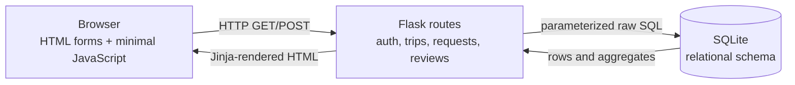

# Technical Design

## Architecture

Campus Ride Match is a server-rendered Flask application backed by one SQLite relational database. It intentionally has no ORM or separate frontend service.

## Components

- `campusride/templates` and `campusride/static`: responsive server-rendered interface, searchable area selection, confirmations, and automatic CSRF fields.
- `campusride/auth.py`: registration, login, profile updates, session identity, and the login guard.
- `campusride/trips.py`: search, publishing, lifecycle management, requests, participants, reviews, and database insights.
- `campusride/notifications.py`: user-owned in-app events.
- `campusride/db.py`: per-request database connection, foreign-key activation, initialization, migration, area synchronization, demo seeding, and invariant audit commands.
- `schema.sql` and `seed.sql`: authoritative fresh-install schema and base demo data.

## Authentication and sessions

Passwords are hashed with Werkzeug and never stored as plaintext. After login, the session contains the user ID; a before-request hook reloads that user from SQLite. State-changing routes require POST and a session CSRF token. The development secret is generated locally in `instance/.secret_key`, while deployment can supply `CAMPUSRIDE_SECRET_KEY`.

## Important data flows

### Search

The browser submits optional date, fixed-area, and time bounds. Flask validates their form, builds only the required parameterized predicates, and executes a multi-table query. Time overlap uses inclusive boundaries. The query joins publisher and two area records, left-joins active participants, groups per trip, and orders open trips first.

### Request and acceptance

A requester creates a `Pending` match request after availability and conflict checks. Acceptance begins an immediate transaction, reloads current state, repeats the conflict check, decrements seats, updates trip/request status, creates the participant and notification, then commits. A rollback leaves every table unchanged if any step fails.

### Withdrawal or removal

One transaction changes the participant from `Active` to `Left` or `Removed`, timestamps the end, restores one seat, returns a full trip to open, cancels the accepted request, and creates the removal notification when applicable.

### Reviews and statistics

Review targets are selected only for completed trips and actual publishers/active participants. The database unique key prevents repeat reviews. Profile ratings and the Insights page calculate results using `AVG`, `COUNT`, `COUNT(DISTINCT ...)`, joins, and `GROUP BY`; no cached analytics table is needed.

## Error handling and integrity boundaries

Form validation produces user-facing messages. Database constraints remain the final defense for invalid statuses, foreign keys, uniqueness, seat bounds, times, and ratings. Multi-row lifecycle operations catch failures, call `rollback()`, and re-raise unexpected errors. Authorization failures return HTTP 403 and missing records return 404.

## Deliberate scope

SQLite and Flask are appropriate for a single-server course demonstration. There is no background scheduler, administrator interface, email delivery, realtime chat, map service, or payment system. The architecture favors explainable relational behavior over production-scale infrastructure.
